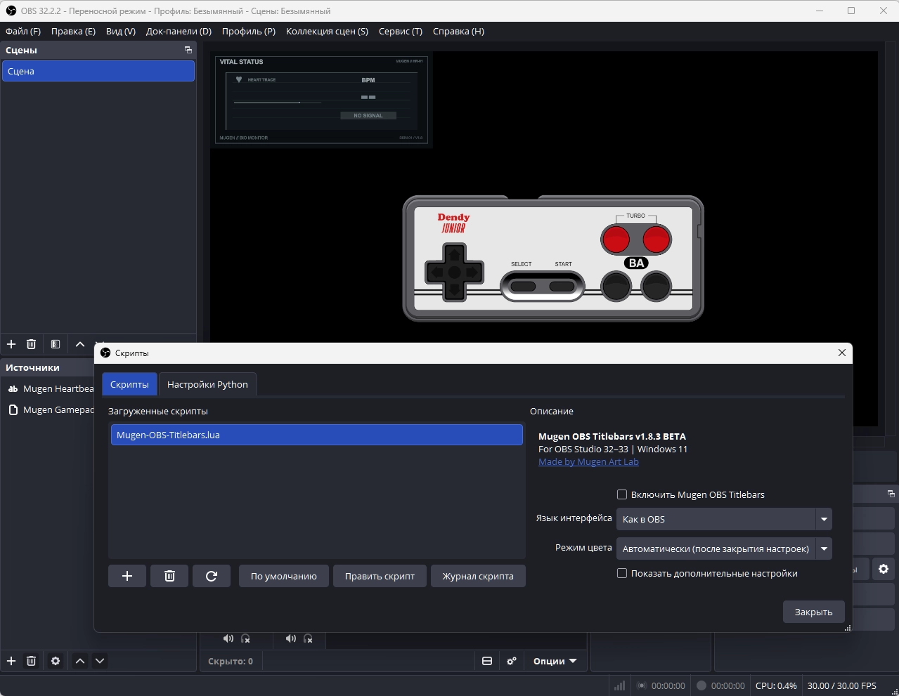
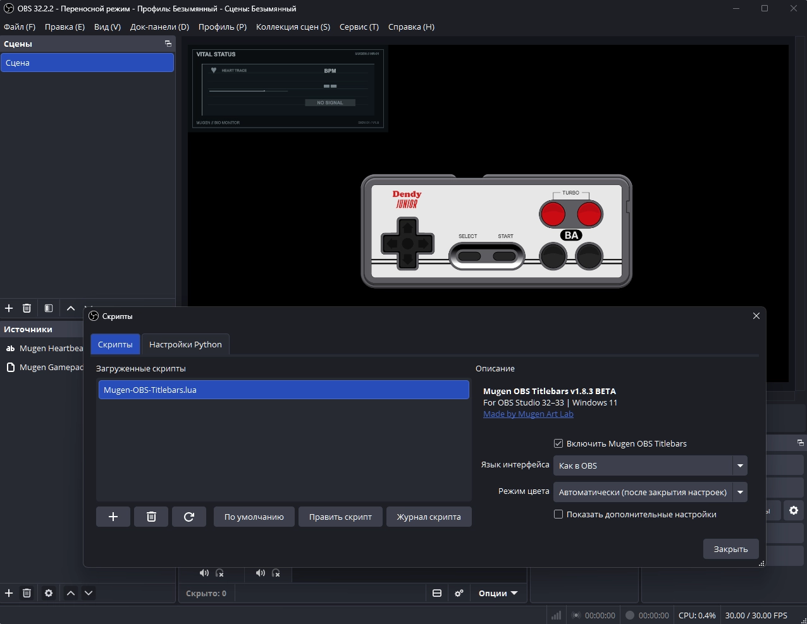

# Mugen OBS Titlebars

**Native Windows title bars that match your OBS Studio theme.**

A small, standalone Lua script for OBS Studio on Windows 11.

[**Русский**](README_RU.md) · **English**

[Website](https://mugenartlab.com) · [Download latest release](https://github.com/Mugen-Art-Lab/Mugen-OBS-Titlebars/releases/latest) · [License](LICENSE) · [Changes](CHANGELOG.md)

---

## Why it exists

OBS Studio can use a dark theme while Windows still draws its native window title bars in a light color. **Mugen OBS Titlebars** makes those captions follow OBS instead of the Windows light/dark preference.

It runs directly in OBS using LuaJIT FFI and Windows APIs. No installer, extra DLL, separate application, background service, cloud account, or network connection is needed to color the windows.

## Before / after

| Script disabled — Windows title bars | Script enabled — matching OBS theme |
| --- | --- |
|  |  |

Actual OBS Studio 32.2.2 Portable screenshots on Windows 11. Only the native window captions change; OBS panels and scene contents are unaffected.

## Features

- Matches the native title-bar background **and text** to installed OBS theme colors.
- **Automatic mode** (default): follows the applied theme after the OBS Settings dialog closes, even when the saved theme setting is stale.
- **Live Preview** (experimental, opt-in): follows visible theme changes *before* you press Apply or OK.
- **Manual mode**: choose your own caption and text colors using `#RRGGBB`.
- Recognizes the bundled Yami styles: Default/Original, Classic, Light, Rachni, Grey and Acri.
- Automatically finds the correct configuration for installed or portable OBS; custom paths are optional.
- Russian and English settings; the default follows the OBS/Windows interface language.
- Restores Windows-controlled title bars when the script is disabled or unloaded.
- Optional on-demand diagnostics and theme-palette self-test.

## Compatibility

| Environment | Status |
| --- | --- |
| OBS Studio **33.0.2**, Windows 11 | Tested: automatic mode, live preview, manual colors, language UI and diagnostics |
| OBS Studio **32.2.2**, **64-bit portable**, Windows 11 | Tested: theme matching, palette parser, separate portable config and repeated startup |
| Other OBS versions / operating systems | Not verified; **Windows 11 only** is the current target |

This is the first **public beta release**. A short functional test is not a guarantee of long-session stability, support for every custom theme, or every monitor/DPI layout.

## Installation

1. Obtain `Mugen-OBS-Titlebars.lua` from this repository or its release ZIP. Keep the Lua file in a permanent folder.
2. Open OBS Studio → **Tools → Scripts** (Russian: **Сервис → Скрипты**).
3. Click **+** and select `Mugen-OBS-Titlebars.lua`.
4. Leave **Enable Mugen OBS Titlebars** checked and **Color mode → Automatic (after closing Settings)** selected.
5. Open OBS **Settings → Appearance**, choose a Yami style and press **OK**. The native captions should match the applied style.

**Portable OBS:** You normally do not need to configure a path. For example, an OBS installation rooted at `D:\OBS-Portable\` uses `D:\OBS-Portable\config\obs-studio\user.ini`. Standard OBS uses `%APPDATA%\obs-studio\user.ini`. An override is available in Advanced settings if needed.

## Modes

| Mode | What to expect |
| --- | --- |
| **Automatic** — default | Uses the current applied palette; does not follow unsaved choices while Settings is open |
| **Live preview (experimental)** | Follows visible Yami palette changes while Settings is open, even before Apply; requires a visible, recognizable OBS menu |
| **Manual colors** | Applies your specified title-bar background and text colors, regardless of OBS theme |

To compare the first two modes, open OBS Settings → Appearance and switch between Yami Light and Default **without** clicking Apply. Automatic should keep the previously applied title-bar color; Live Preview should follow the new visible palette. Canceling the dialog returns to the prior applied appearance in OBS.

## Language and diagnostics

The Scripts panel supports **Follow OBS**, **English** and **Русский**. Language selection affects the script's settings; the short description remains language-neutral.

Enable **Show advanced settings** to access:

- **Additional theme folder** — optional custom theme directory.
- **OBS user.ini override** — optional explicit config-file path, taking priority over automatic detection.
- **Write diagnostics to script log** — prints config source, saved/detected theme and last confirmed match.
- **Test Yami palette parser** — checks installed Yami files using the actual Lua parser. Six passes are expected for an unmodified standard Yami set; edited or absent files may differ.

The **Script Log** may be empty during ordinary use: color updates do not repeatedly write log messages.

## Limitations and troubleshooting

**Title bars briefly appear in the Windows color at startup.** OBS creates its window before Lua scripts load. This short flash is expected.

**Title bars turn light when the script is disabled.** That is the original Windows-controlled appearance; disabling or unloading the script intentionally restores Windows defaults.

**A color does not update.** Check that the script is enabled, OBS's Settings dialog has been closed in Automatic mode, and the active theme exposes a supported solid palette color. If automatic detection is uncertain because the menu is covered, the script retains the last confirmed color or falls back to the saved theme. Try Manual mode for an unsupported custom theme.

**Theme files or configuration are not found.** Use Advanced settings → Write diagnostics to script log. Installed and portable OBS configs are detected separately. You can provide an explicit `user.ini` or theme-folder path if necessary.

**OBS becomes unresponsive.** Do not test fixes during a broadcast. End OBS from Task Manager if necessary, temporarily rename the Lua file to disable its loading, restart OBS and remove the script entry. Report the OBS version, steps to reproduce and relevant OBS logs in the project's issue tracker.

Live Preview samples a few **on-screen menu pixels** to recognize theme colors; it does **not** save screenshots. Screen scaling, hidden or overlapped menus, custom themes and unusual window placement may prevent a confident match. Theme file lookup currently uses some ANSI Windows paths, so non-ASCII install paths may require an override. LuaJIT FFI runs inside OBS; use the script at your own discretion.

## License and credits

MIT License — see [LICENSE](LICENSE).

Copyright © 2026 **MrSoichi / Mugen Art Lab**.

**Made by [Mugen Art Lab](https://mugenartlab.com)** — an independent personal project creating practical tools for streaming and creative workflows.

Mugen OBS Titlebars is an independent community tool and is **not an official OBS Studio plugin** or affiliated with the OBS Project.
