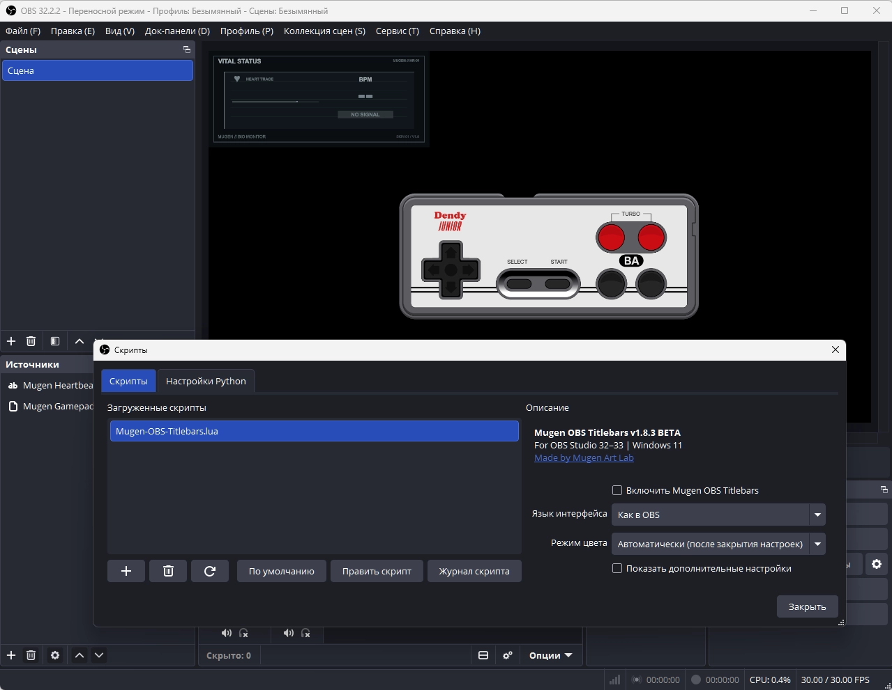
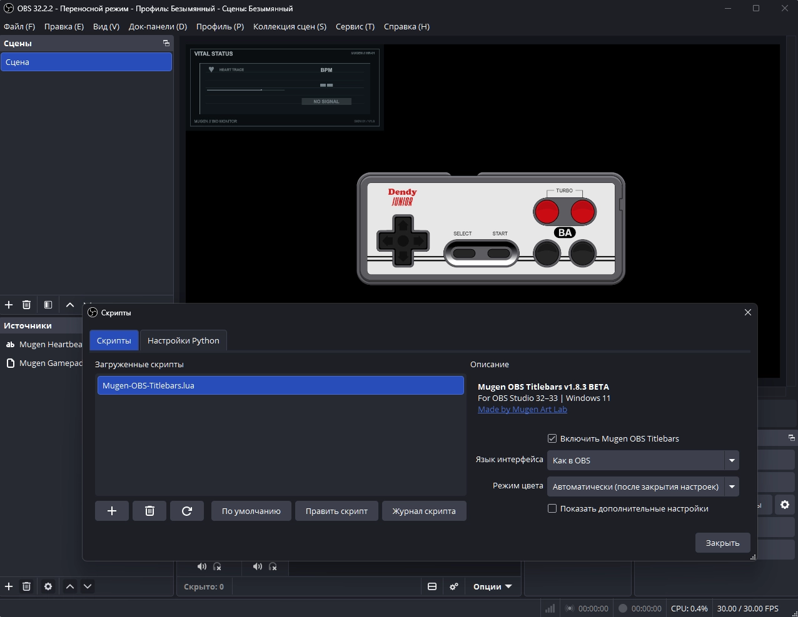

# Mugen OBS Titlebars

**Заголовки окон Windows в цвет темы OBS Studio.**

Небольшой самостоятельный Lua-скрипт для OBS Studio под Windows 11.

**Русский** · [**English**](README.md)

[Сайт](https://mugenartlab.com) · [Лицензия](LICENSE) · [История изменений](CHANGELOG.md)

---

## Зачем он нужен

OBS Studio может использовать тёмную тему, а Windows при этом рисует стандартные заголовки окон светлыми. **Mugen OBS Titlebars** окрашивает системные заголовки и их текст в цвета OBS независимо от светлой или тёмной темы Windows.

Скрипт работает непосредственно в OBS через LuaJIT FFI и Windows API. Для окрашивания не нужны установщик, дополнительные DLL, отдельная программа, фоновый сервис, облачный аккаунт или подключение к интернету.

## До и после

| Скрипт выключен — системные заголовки Windows | Скрипт включён — в цвет темы OBS |
| --- | --- |
|  |  |

Настоящие снимки OBS Studio 32.2.2 Portable под Windows 11. Меняются только системные заголовки окон — панели и содержимое сцен остаются прежними.

## Возможности

- Подбирает цвет **фона заголовка и текста** по установленной теме OBS.
- **Автоматический режим** (по умолчанию): учитывает применённую тему после закрытия настроек OBS, даже если сохранённая настройка устарела.
- **Живой предпросмотр** (экспериментальный): отслеживает изменение видимого оформления *до* нажатия «Применить» или «ОК».
- **Ручной режим**: свои цвета заголовка и текста в формате `#RRGGBB`.
- Поддерживает стандартные стили Yami: Default/Original, Classic, Light, Rachni, Grey и Acri.
- Самостоятельно обнаруживает конфигурацию обычного и портативного OBS; пути можно задать вручную.
- Русский и английский интерфейс настроек, с автоматическим выбором по языку OBS/Windows.
- Восстанавливает стандартные цвета заголовков Windows при отключении или выгрузке скрипта.
- Дополнительная диагностика и проверка палитр по запросу.

## Совместимость

| Среда | Статус |
| --- | --- |
| OBS Studio **33.0.2**, Windows 11 | Проверены автоматический режим, предпросмотр, свои цвета, языки интерфейса и диагностика |
| OBS Studio **32.2.2**, **64-битная портативная версия**, Windows 11 | Проверены окрашивание, парсер палитр, отдельная конфигурация и повторные запуски |
| Другие версии OBS и системы | Не проверены; сейчас целевая система — **Windows 11** |

Это **бета-версия (предрелиз)**. Успешные короткие проверки не гарантируют стабильность во время длительных трансляций, работу со всеми сторонними темами или необычными конфигурациями мониторов и масштабирования.

## Установка

1. Получите `Mugen-OBS-Titlebars.lua` из репозитория или ZIP-архива релиза. Сохраните Lua-файл в постоянной папке.
2. Откройте OBS Studio → **Сервис → Скрипты**.
3. Нажмите **+** и выберите `Mugen-OBS-Titlebars.lua`.
4. Оставьте включённой галочку **«Включить Mugen OBS Titlebars»**, а в **«Режим цвета»** выберите **«Автоматически (после закрытия настроек)»**.
5. Откройте **Настройки OBS → Внешний вид**, выберите стиль Yami и нажмите **«ОК»**. Системные заголовки должны принять цвет выбранного оформления.

**Портативный OBS:** обычно ничего дополнительно настраивать не нужно. Например, для папки `D:\OBS-Portable\` конфигурация находится в `D:\OBS-Portable\config\obs-studio\user.ini`. Обычная установка использует `%APPDATA%\obs-studio\user.ini`. При необходимости путь можно переопределить в дополнительных настройках.

## Режимы окраски

| Режим | Что происходит |
| --- | --- |
| **Автоматически** — по умолчанию | Используется применённое оформление; несохранённый выбор темы внутри открытых настроек не меняет заголовок |
| **Живой предпросмотр (эксперимент)** | Пока окно настроек открыто, цвет заголовка меняется вместе с видимой темой Yami до нажатия «Применить»; важно, чтобы меню OBS можно было распознать |
| **Свои цвета** | Заголовки окрашиваются в заданные вручную цвета, независимо от темы OBS |

Чтобы увидеть разницу, откройте OBS → **Настройки → Внешний вид** и переключите стиль Yami между Light и Default **без** нажатия «Применить». В Auto цвет заголовка остаётся прежним; в Live Preview он повторяет предварительный просмотр. После «Отмена» фактически применённая тема OBS остаётся прежней.

## Язык и диагностика

В окне скриптов доступны варианты **«Как в OBS»**, **English** и **Русский**. Выбранный язык применяется к параметрам скрипта; короткое описание над ними остаётся нейтральным.

Включите **«Показать дополнительные настройки»**, чтобы увидеть:

- **Дополнительная папка тем** — необязательная папка со своими темами.
- **Другой путь к OBS user.ini** — ручной путь к конфигурации, имеет приоритет над автоопределением.
- **Записать диагностику в журнал** — выводит источник конфигурации, сохранённую/распознанную тему и последнее подтверждённое совпадение.
- **Проверить палитры Yami** — проверяет установленные темы реальным Lua-парсером. Для неизменённого стандартного набора Yami ожидается шесть успешных проверок; при изменённых или отсутствующих файлах результат может отличаться.

**Журнал скрипта** при обычной работе может быть пустым: каждая смена цвета не сопровождается записью в лог.

## Ограничения и решение проблем

**При запуске на мгновение появляется белая шапка.** Сначала OBS создаёт окно и только потом загружает Lua-скрипты. Это ожидаемое кратковременное поведение.

**После снятия галочки заголовки снова светлые.** При отключении или выгрузке скрипт намеренно возвращает стандартное оформление Windows.

**Заголовок не меняет цвет.** Проверьте, что скрипт включён, окно настроек OBS закрыто (для Auto), а выбранная тема содержит поддерживаемые обычные цвета. Если верхнее меню перекрыто, скрипт сохраняет последний надёжно распознанный цвет или использует сохранённую тему. Для необычной сторонней темы попробуйте ручной режим.

**Не находятся файлы темы или настройки OBS.** Откройте дополнительные настройки, нажмите **«Записать диагностику в журнал»**. Скрипт определяет обычную и портативную конфигурации отдельно; при необходимости укажите путь к `user.ini` или папке темы.

**OBS перестал отвечать.** Не проводите эксперименты во время трансляции. При необходимости завершите OBS через Диспетчер задач, временно переименуйте Lua-файл, чтобы отключить его загрузку, перезапустите OBS и удалите скрипт из списка. Для сообщения об ошибке подготовьте версию OBS, последовательность действий и соответствующий журнал OBS.

Live Preview считывает несколько **пикселей видимого меню** для распознавания темы, но **не сохраняет скриншоты**. Другое масштабирование, скрытое меню, перекрывающие окна, сторонние темы и необычное положение OBS могут мешать распознаванию. Часть поиска файлов пока использует ANSI-пути Windows, поэтому при нестандартных символах в пути может понадобиться ручная настройка. LuaJIT FFI работает внутри процесса OBS; используйте скрипт с учётом этого ограничения.

## Лицензия и авторство

Лицензия MIT — см. [LICENSE](LICENSE).

Copyright © 2026 **MrSoichi / Mugen Art Lab**.

**Made by [Mugen Art Lab](https://mugenartlab.com)** — независимый личный проект по созданию полезных инструментов для стримеров и творческих задач.

Mugen OBS Titlebars — независимый проект сообщества, **неофициальное расширение OBS Studio**, не связанное с OBS Project.
